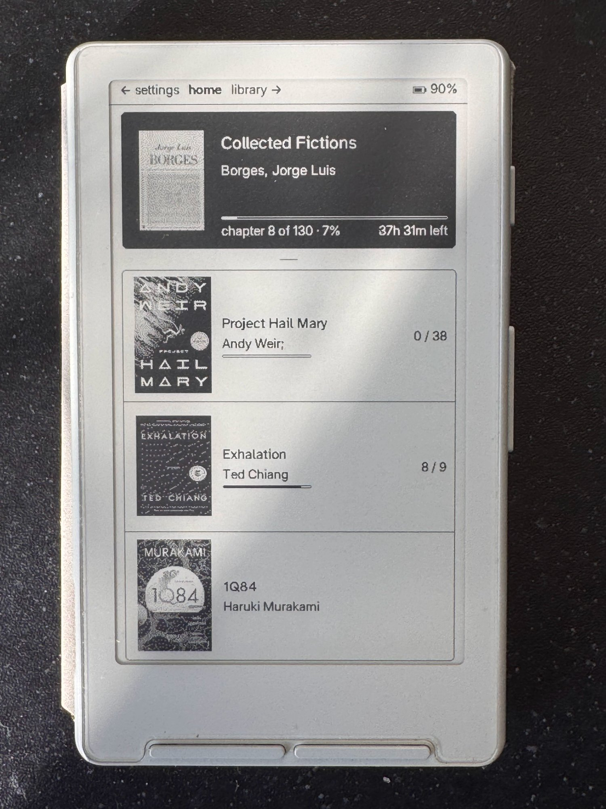
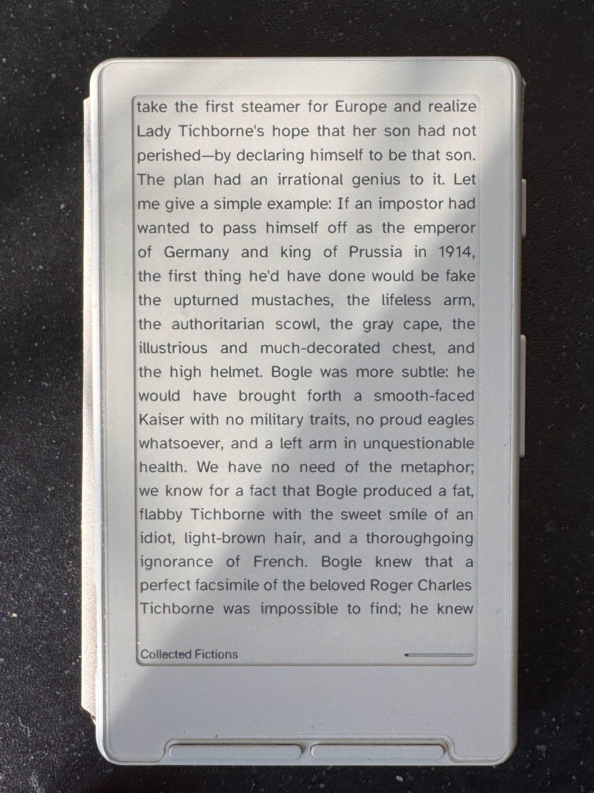
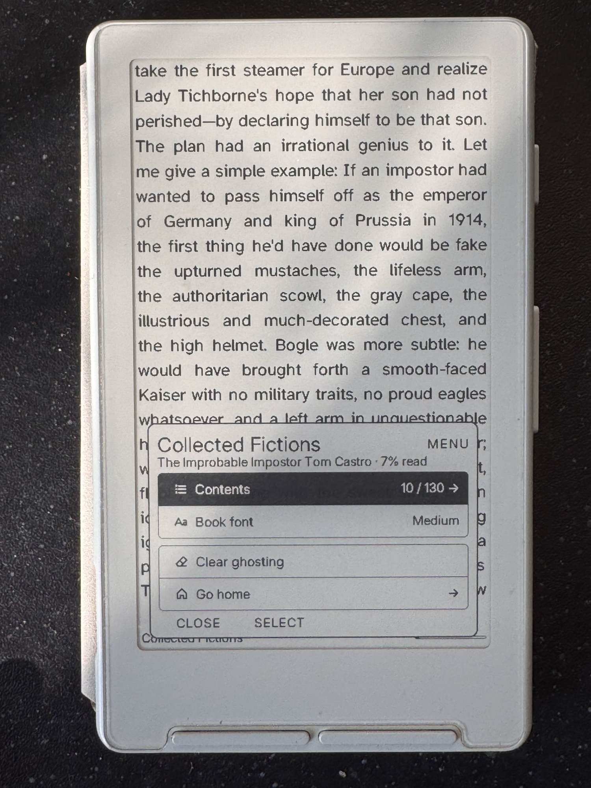
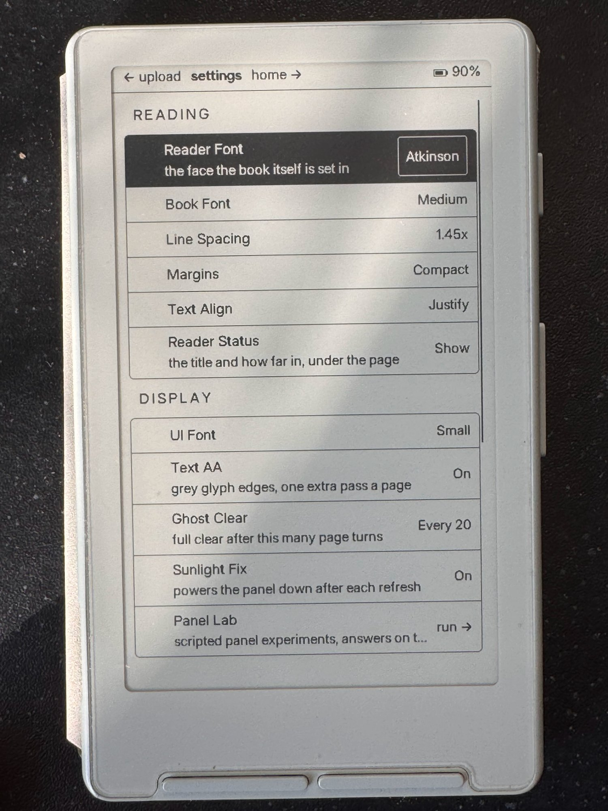
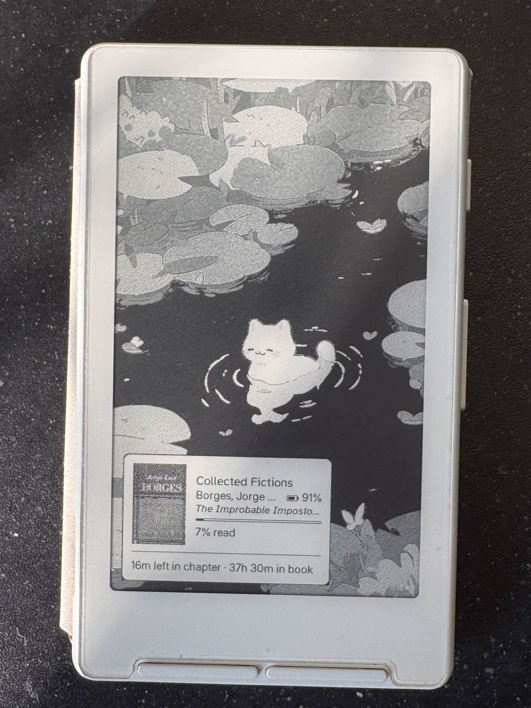
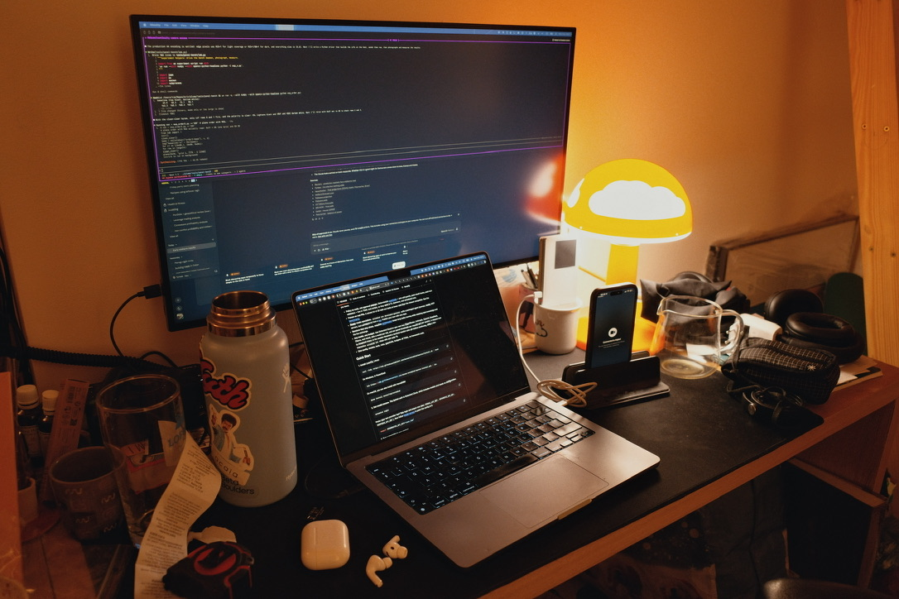

# plump

Custom firmware for the [XTEink X4](https://github.com/xteink) e-reader, written in Rust. Bare metal, `#![no_std]`, no framebuffer, async via Embassy on esp-rtos.
It reads EPUB and plain `.txt`, justifies text with a Knuth-Plass line breaker, dithers inline images to 1-bit and turns a page in about 400 ms. Books go on over WiFi from a browser at `http://plump.local/`.

<p align="center">
  
  
  
  
  
</p>

## How it's put together

It's split into a kernel (`kernel/`: drivers, scheduler, storage, EPD rendering) and a distro (`src/`: apps, fonts, UI). The kernel has zero imports from the app layer, and a port to the Eegoread A4 is planned.

The X4 is an ESP32-C3 with 400 KB of RAM, and about 210 KB of that is heap. A framebuffer for the 800×480 panel would take 48 KB, so the screen is drawn in 12 strips through one 4 KB buffer instead. Only the EPUB reader and the image decoder allocate; everything else lives in statics or on a 58 KB stack.

## Build

Needs stable Rust ≥ 1.88 and [`espflash`](https://github.com/esp-rs/espflash). With the device plugged in over USB:

```sh
cargo run --release   # build, flash, open the serial monitor
```

All the info about the architecture and the dev loop is in `AGENTS.md`. Point your agents to it and they should figure things out (:

## Fun trivia from development

Here's the setup I used to let Claude debug the display drivers in a loop.

<p align="center">
  
</p>

MIT, see [LICENSE](LICENSE).
Thanks to @hansmrtn for his work on [hansmrtn/pulp-os](https://github.com/hansmrtn/pulp-os). This OS is based on his initial work.
